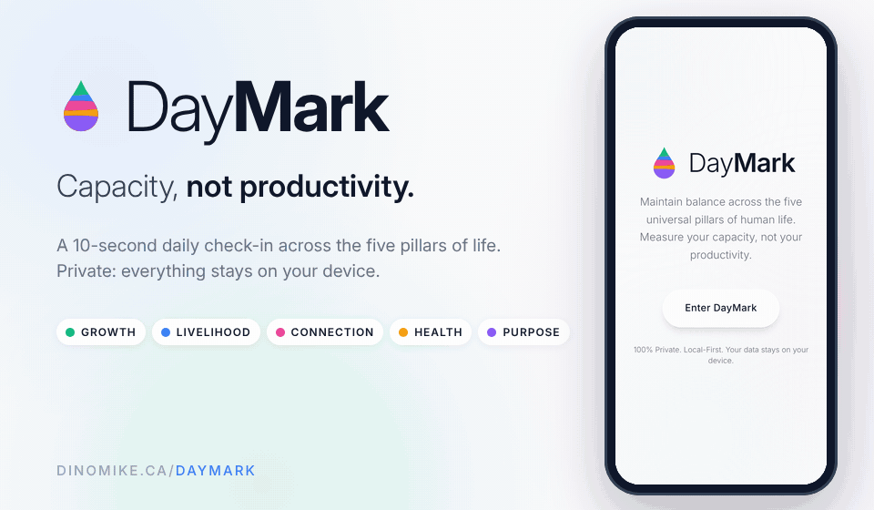

# DayMark



**Capacity, not productivity.**

DayMark is a daily check-in for the five pillars of a life: **Growth, Livelihood, Connection, Health and
Purpose**. Once a day you drag each liquid-filled vial to where you are, tap **Log Today**, and over
time it shows how your capacity moves: a 60-day timeline and plain-language observations about what's
rising, what's slipping and what moves together. It doesn't count tasks or minutes; it asks how full
each part of your life feels.

Created by **Mike Warren** ([@dinosaurmike](https://github.com/dinosaurmike)).

**Try it: <https://dinomike.ca/DayMark/>** (works best on a phone; add it to your home screen)

---

## What it does

**Check in**
- Five vials, one per pillar. Drag the liquid to set today's level from 0 to 100; each has a target
  line (70 by default).
- **Log Today** saves the day.

**See the pattern**
- **60-day timeline** of all five pillars, with the values for any day on hover or tap.
- **Observations** from your own history, once you have two weeks of check-ins. For example:
  - a pillar that has risen or fallen over the last two weeks;
  - Health below your own average;
  - Livelihood and Purpose moving together (a real correlation over the last 30 days);
  - your current logging streak.

**Make it yours**
- Rename the five vials and set your own target for each in the profile.
- **Share** today's levels: copy them as text or save them as an image (JPG).
- **100% private, local-first.** No account and no server: everything is kept in your browser's
  local storage on your device. **Sign Out (Clear Data)** deletes it.

## How it's built

- A **React** single-page app built with **Vite**, with **React Router** for the screens,
  **Framer Motion** for the springy liquid vials and transitions, **Recharts** for the timeline, and
  **Tailwind CSS** with a frosted-glass look. Font: Inter.
- Data: one `daymark_data` list of daily entries (date, five values, notes) and one `daymark_pillars`
  list (names, colours and targets), both in `localStorage`.
- Built with Claude Code as a coding partner.

### What's in this repository

```
index.html          the app (loads assets/)
assets/             the built bundle: index-dm1.js (React, the app) and index-<hash>.css
logo.svg, favicon.svg, icons.svg
docs/images/        README header (GIF) and social preview, with the scripts that make them (source/)
```

This is the **built** app, ready to host. The original source project isn't included here yet.

To run it locally, serve the folder:

```bash
python3 -m http.server 8000
# open http://localhost:8000
```

## License

© 2026 Mike Warren. All rights reserved. The code is shared here so you can see the work; it isn't
licensed for reuse. See [LICENSE](LICENSE). The libraries and fonts inside the build keep their own
licences.
